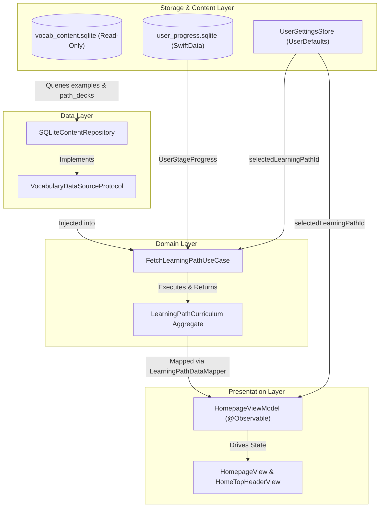

# Design Specification: SQL Content Examples Integration & Multi-Path Journey Architecture

**Date**: 2026-10-10  
**Status**: Approved  
**Author**: Antigravity Pair Programming  

---

## 1. Overview & Problem Statement

This specification defines the complete architectural design and implementation requirements for two key areas in `VocabCraft`:
1. **Fix SQL Content Missing Examples**: In the production SQLite database (`vocab_content.sqlite`), the `examples` table contains 8,412 high-quality bilingual example sentences, but `SQLiteContentRepository` hardcodes empty strings (`exampleEn: ""` and `exampleVi: ""`) and omits subqueries for examples in `fetchWordsForStage`, `searchWords`, and `fetchWordById`. Consequently, lesson learning views, reflex drill modes (cloze masking), and the personal vault display vocabulary without real example sentences.
2. **Multi-Path Journey Architecture**: The SQLite database defines relational tables for `learning_paths` and `path_decks` (categorized by learning goals such as `general`, `exam_prep`, `business`, `travel`, `academic`). However, the app previously fetched all 48 decks sequentially without filtering by the user's selected learning path, and lacked storage for the user's active learning path choice.

This design unifies content extraction from SQLite and establishes a domain-centric multi-path journey architecture while preserving full backward compatibility and strict offline-first guarantees.

---

## 2. Root Cause Analysis: Missing Examples in SQL Content

- **File**: `VocabCraftApp/Core/Database/DataSources/SQLiteContentRepository.swift`
- **Issue**:
  - In `parseWord(stmt:stageId:)`, properties 7 and 8 are hardcoded as empty strings:
    ```swift
    exampleEn: "",
    exampleVi: ""
    ```
  - The `SELECT` queries in `fetchWordsForStage(stageId:)`, `searchWords(query:)`, and `fetchWordById(id:)` join `senses` with `entries` and subquery `pronunciations`, but never query the `examples` table.
- **Impact**:
  - In `LessonLearningView`, examples are blank.
  - In `ReflexBlitzViewModel` and `ReflexSpeechMatcher`, cloze sentences fallback to `"The word is \(word.lemma)."` instead of real contextual sentences.
  - In `PersonalVaultView` and `VocabWidget`, example sentences are unavailable.

---

## 3. Architecture & Component Design



### 3.1 Data Layer

#### 3.1.1 `LearningPathDTO`
Add to `VocabularyDataSourceProtocol.swift`:
```swift
public struct LearningPathDTO: Identifiable, Sendable, Equatable, Codable {
    public let id: String
    public let code: String
    public let titleEn: String
    public let titleVi: String
    public let descriptionEn: String?
    public let descriptionVi: String?
    public let goalCategory: String // 'general', 'exam_prep', 'business', 'travel', 'academic'
    public let targetLevelMin: String // 'A1'
    public let targetLevelMax: String // 'C2'
    public let iconKey: String
    public let themeKey: String
    public let sortOrder: Int

    public init(
        id: String,
        code: String,
        titleEn: String,
        titleVi: String,
        descriptionEn: String? = nil,
        descriptionVi: String? = nil,
        goalCategory: String,
        targetLevelMin: String,
        targetLevelMax: String,
        iconKey: String,
        themeKey: String,
        sortOrder: Int
    ) {
        self.id = id
        self.code = code
        self.titleEn = titleEn
        self.titleVi = titleVi
        self.descriptionEn = descriptionEn
        self.descriptionVi = descriptionVi
        self.goalCategory = goalCategory
        self.targetLevelMin = targetLevelMin
        self.targetLevelMax = targetLevelMax
        self.iconKey = iconKey
        self.themeKey = themeKey
        self.sortOrder = sortOrder
    }
}
```

#### 3.1.2 `VocabularyDataSourceProtocol` Extension
```swift
public protocol VocabularyDataSourceProtocol: Sendable {
    // Existing methods: fetchTopicDecks(), fetchSubTopicStages(), fetchWordsForStage(), searchWords(), fetchWordById()
    func fetchLearningPaths() async throws -> [LearningPathDTO]
    func fetchTopicDecks(for pathId: String) async throws -> [TopicDeckDTO]
}

public extension VocabularyDataSourceProtocol {
    func fetchLearningPaths() async throws -> [LearningPathDTO] {
        // Safe default fallback for mock / bundled implementations
        [
            LearningPathDTO(
                id: "7147ba7e-0728-471d-97af-f3e2262a6d23",
                code: "essential-english-mastery",
                titleEn: "Core Curriculum: Comprehensive English",
                titleVi: "Lộ Trình Cốt Lõi: Tiếng Anh Giao Tiếp",
                goalCategory: "general",
                targetLevelMin: "A1",
                targetLevelMax: "C2",
                iconKey: "compass",
                themeKey: "ocean_blue",
                sortOrder: 0
            )
        ]
    }

    func fetchTopicDecks(for pathId: String) async throws -> [TopicDeckDTO] {
        try await fetchTopicDecks()
    }
}
```

#### 3.1.3 `SQLiteContentRepository` Implementation
1. **Examples SQL Subqueries**:
   Update `fetchWordsForStage(stageId:)`, `searchWords(query:)`, and `fetchWordById(id:)`:
   ```sql
   SELECT s.rowid, e.headword, s.part_of_speech, s.definition_en, s.definition_vi, s.cefr_level,
          (SELECT p.ipa FROM pronunciations p WHERE p.sense_id = s.id LIMIT 1) as ipa,
          (SELECT ex.text_en FROM examples ex WHERE ex.sense_id = s.id ORDER BY ex.sort_order LIMIT 1) as example_en,
          (SELECT ex.text_vi FROM examples ex WHERE ex.sense_id = s.id ORDER BY ex.sort_order LIMIT 1) as example_vi
   FROM senses s
   JOIN lesson_senses ls ON ls.sense_id = s.id
   JOIN entries e ON s.entry_id = e.id
   WHERE ls.lesson_id = ?
   ORDER BY ls.sort_order;
   ```
2. **`parseWord` Update**:
   - Column 7 -> `exampleEn = columnString(stmt, 7)`
   - Column 8 -> `exampleVi = columnString(stmt, 8)`
3. **`fetchLearningPaths()`**:
   ```sql
   SELECT id, code, title_en, title_vi, description_en, description_vi,
          goal_category, target_level_min, target_level_max, icon_key, theme_key, sort_order
   FROM learning_paths
   ORDER BY sort_order;
   ```
4. **`fetchTopicDecks(for pathId: String)`**:
   ```sql
   SELECT d.id, d.title_en, d.icon_key, d.theme_key, pd.sort_order, d.ios_sf_symbol
   FROM decks d
   JOIN path_decks pd ON pd.deck_id = d.id
   WHERE pd.path_id = ?
   ORDER BY pd.sort_order;
   ```
   *Defensive Fallback*: If the result is empty, log a debug warning and fallback to `fetchTopicDecks()`.

---

### 3.2 Storage Layer

#### 3.2.1 `UserSettingsStore` & `UserRoadmapSettingsProtocol`
- Extend `UserRoadmapSettingsProtocol`:
  ```swift
  public protocol UserRoadmapSettingsProtocol: Sendable {
      var selectedGoalDeckId: String { get }
      var assessedCefrLevel: String { get }
      var dailyGoalCount: Int { get }
      var notificationTimeInterval: Double { get }
      var selectedLearningPathId: String? { get set }
      func saveRoadmapPreferences(deckId: String, cefrLevel: String, dailyGoalCount: Int, notificationTimeInterval: Double)
      func saveLearningPathPreference(pathId: String)
  }
  ```
- In `UserSettingsStore`:
  - Add stored property:
    ```swift
    public var selectedLearningPathId: String? {
        get { defaults.string(forKey: "selected_learning_path_id") }
        set { defaults.set(newValue, forKey: "selected_learning_path_id") }
    }
    ```
  - Implement `saveLearningPathPreference(pathId: String)`:
    ```swift
    public func saveLearningPathPreference(pathId: String) {
        self.selectedLearningPathId = pathId
    }
    ```

---

### 3.3 Domain Layer

#### 3.3.1 `LearningPathCurriculum`
Update aggregate to include `activePath: LearningPathDTO?`:
```swift
public struct LearningPathCurriculum: Sendable, Equatable {
    public let activePath: LearningPathDTO?
    public let decks: [TopicDeckDTO]
    public let stages: [SubTopicStageDTO]
    public let words: [TopicWordDTO]
    public let progressList: [UserStageProgressData]

    public init(
        activePath: LearningPathDTO? = nil,
        decks: [TopicDeckDTO],
        stages: [SubTopicStageDTO],
        words: [TopicWordDTO],
        progressList: [UserStageProgressData]
    ) {
        self.activePath = activePath
        self.decks = decks
        self.stages = stages
        self.words = words
        self.progressList = progressList
    }
}
```

#### 3.3.2 `FetchLearningPathUseCase`
- Extend protocol:
  ```swift
  public protocol FetchLearningPathUseCaseProtocol: Sendable {
      func execute(pathId: String?, forceRefresh: Bool) async throws -> LearningPathCurriculum
      func execute(forceRefresh: Bool) async throws -> LearningPathCurriculum
      func execute() async throws -> LearningPathCurriculum
  }
  ```
- Dependency injection:
  ```swift
  public init(
      dataSource: VocabularyDataSourceProtocol,
      stageRepo: StageProgressRepositoryProtocol,
      userSettings: UserRoadmapSettingsProtocol? = nil
  )
  ```
- Resolution flow:
  1. Determine `targetPathId = pathId ?? userSettings?.selectedLearningPathId`.
  2. Query `paths = try await dataSource.fetchLearningPaths()`.
  3. Resolve `activePath`: Match `paths.first { $0.id == targetPathId }` or default to `paths.first`.
  4. Fetch decks: `try await dataSource.fetchTopicDecks(for: activePath?.id ?? "")`.
  5. Fetch stages & words concurrently via task group.
  6. Return `LearningPathCurriculum(activePath: activePath, decks: decks, stages: stages, words: words, progressList: progressList)`.

---

### 3.4 Presentation Layer

#### 3.4.1 `HomepageViewModel`
- Properties:
  ```swift
  public private(set) var activeLearningPath: LearningPathDTO?
  ```
- `loadLearningPath()`:
  - Invokes `useCase.execute(pathId: userSettings?.selectedLearningPathId, forceRefresh: false)`.
  - Sets `self.activeLearningPath = curriculum.activePath`.
  - Maps `sections = LearningPathDataMapper.map(curriculum: curriculum)`.
- Method `switchLearningPath(to pathId: String) async`:
  - Saves to `userSettings?.saveLearningPathPreference(pathId: pathId)`.
  - Re-executes `loadLearningPath()`.

#### 3.4.2 UI Header Integration in `HomepageView`
- Render an active roadmap indicator in `HomeTopHeaderView` or as a sub-header card using `CraftBadge` and `CraftFont`:
  - Displays the localized title of the active learning path (e.g. `curriculum.activePath.titleVi` / `titleEn`).
  - Displays target CEFR range (e.g. `A1 - C2`).
- All text strings declared in `Localizable.xcstrings`:
  - `app.home.learning_path.title`
  - `app.home.learning_path.level_format` (`%@ - %@`)
  - `app.home.learning_path.badge`

---

## 4. Error Handling & Invariants

1. **Missing / Empty Examples**:
   - `columnString(stmt, index)` returns `""` if SQLite column is `NULL`.
   - Domain models tolerate empty examples safely with graceful UI fallback.
2. **Missing Learning Path / Corrupted ID**:
   - If `pathId` does not match any row in `learning_paths`, `SQLiteContentRepository.fetchTopicDecks(for:)` falls back to `fetchTopicDecks()` (all decks).
   - If `learning_paths` table is empty, default static `LearningPathDTO` is constructed.
3. **Swift 6 Strict Concurrency**:
   - All DTOs are `@Sendable` and immutable value types.
   - `SQLiteContentRepository` maintains thread-safe access with `SQLITE_OPEN_FULLMUTEX`.
   - `FetchLearningPathUseCase` uses internal actor `StaticCurriculumCache` for static data caching.
   - `HomepageViewModel` is isolated to `@MainActor`.

---

## 5. Localization & Design System Tokens

- **Zero Hardcoded Strings**:
  - Keys added to `VocabCraftApp/Resources/Localizable.xcstrings`:
    - `app.home.learning_path.badge`: EN = "Active Journey", VI = "Lộ trình hiện tại"
    - `app.home.learning_path.level_range`: EN = "Level %@ to %@", VI = "Trình độ %@ đến %@"
    - `app.home.learning_path.switch_action`: EN = "Switch Journey", VI = "Đổi lộ trình"
  - Format specifiers identical across EN and VI (`%@`).
- **CraftUIKit Token Discipline**:
  - Backgrounds: `theme.colors.surfaceContainer`, `theme.colors.surfaceSubtle`
  - Text: `theme.colors.textPrimary`, `theme.colors.textSecondary`
  - Typography: `theme.typography.labelMedium`, `theme.typography.titleMedium`
  - Spacing & Radius: `theme.spacing.sm`, `theme.spacing.base`, `theme.radius.md`

---

## 6. Verification & Quality Gates

1. **Unit Tests**:
   - `SQLiteContentRepositoryTests.swift`:
     - Test that `fetchWordsForStage` returns non-empty `exampleEn` and `exampleVi`.
     - Test that `fetchWordById` returns non-empty example sentences.
     - Test that `fetchLearningPaths` returns `essential-english-mastery`.
     - Test that `fetchTopicDecks(for:)` returns correct decks linked via `path_decks`.
     - Test fallback when `pathId` is invalid.
   - `FetchLearningPathUseCaseTests.swift`:
     - Test curriculum resolution with specific `pathId`.
     - Test curriculum resolution defaulting to `userSettings.selectedLearningPathId`.
   - `HomepageViewModelTests.swift`:
     - Test loading path and populating `activeLearningPath`.
     - Test `switchLearningPath(to:)`.
2. **Regression & Health Checks**:
   - `swift test --filter LocalizationTests`
   - `swift test` (full suite)
   - `swiftlint` (0 errors, 0 warnings)
   - Xcode build with 0 warnings.
