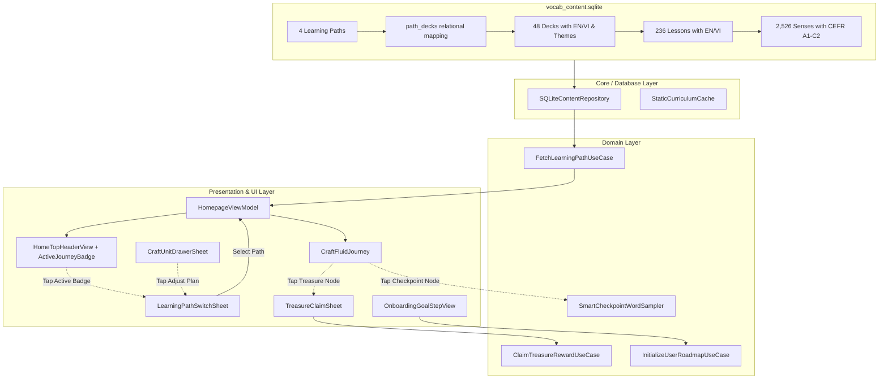

# Learning Path Comprehensive Enhancement Design Spec

- **Date**: 2026-10-18
- **Status**: Approved by User
- **Authors**: Antigravity & Pair Programming Partner

---

## 1. Executive Summary

This specification outlines the comprehensive architectural enhancement and bug remediation for the **Learning Path** subsystem in `VocabCraftApp`. 

Following the import of the 48 curated vocabulary topic decks, lessons, and senses into the offline relational database (`vocab_content.sqlite`), this upgrade resolves critical operational deficiencies in milestone progression, introduces an intelligent checkpoint review mechanism, activates bilingual (EN/VI) curriculum presentation, and establishes a versatile **Multi-Path Learning System** with seamless path switching and onboarding synchronization.

---

## 2. Core Problem Statements & Audit Findings

1. **Broken Milestone Progression (Treasure Chests)**:
   - When a learner finishes a Unit and attempts to claim the unlocked Treasure Chest node (`kind: .treasureChest`), `HomepageView.startLesson(for:)` erroneously treats `treasure_<deckId>` as a standard vocabulary stage ID.
   - Querying `fetchWordsForStage(stageId: "treasure_...")` returns zero words, triggering an error toast (*"Failed to load lesson"*). The bonus XP (+150 XP) is never awarded, and progress is not recorded.

2. **Overwhelming Checkpoint Drill Size**:
   - Tapping the Unit Checkpoint (`checkpoint_<deckId>`) aggregates all words across all sub-stages in that deck (~50–60 words).
   - Passing 60 words to `LessonLearningViewModel` produces an exhaustive 120-step session, violating micro-learning ergonomics and creating cognitive fatigue.

3. **Bilingual Content Loss & Hardcoded CEFR**:
   - `vocab_content.sqlite` contains rich, high-quality Vietnamese translations (`title_vi`, `description_vi`) for all 48 decks and 236 lessons. However, `TopicDeckDTO` and `SubTopicStageDTO` only map `title_en`, discarding Vietnamese titles.
   - In `SQLiteContentRepository.fetchTopicDecks`, `cefrLevel` is hardcoded to `"A1"` for every deck, disregarding actual CEFR distribution across levels A1 to C2.

4. **Single-Path Limitation & Disconnected Onboarding**:
   - The database only contains a single generic path (`essential-english-mastery`). Specialized goals (`business`, `academic`, `travel`) supported by the SQLite schema remain unpopulated.
   - Onboarding (`OnboardingGoalStepView`) still displays legacy mock IDs (`deck_daily`, `deck_business`), throwing `stageNotFound` when run against SQLite.
   - The UI lacks an interactive mechanism for learners to view overall roadmap progress or switch active learning paths.

---

## 3. Phased Solution Architecture

The enhancement is executed across two coherent phases:
- **Phase 1: Core Mechanics & Bugfixes** (Treasure Chest claim, Smart Checkpoint word sampling, Bilingual DTOs, Dynamic CEFR aggregation).
- **Phase 2: Multi-Path System & Switcher UI** (4 Curated Learning Paths in SQLite, Interactive `ActiveJourneyBadge`, `LearningPathSwitchSheet` with 3 entry points, Onboarding alignment).



---

## 4. Phase 1 Detailed Specifications: Core Mechanics & Bugfixes

### 4.1 Instant Claim Treasure Chest (`ClaimTreasureRewardUseCase` & `TreasureClaimSheet`)

#### Domain Logic: `ClaimTreasureRewardUseCase`
- **Protocol**:
  ```swift
  public protocol ClaimTreasureRewardUseCaseProtocol: Sendable {
      func execute(deckId: String) async throws -> TreasureRewardResult
  }
  ```
- **Execution Rules**:
  1. **Validation**: Check `StageProgressRepository.fetchStageProgress(stageId: "checkpoint_\(deckId)")`. The checkpoint must be completed (`isCompleted == true`).
  2. **Idempotence**: Check `fetchStageProgress(stageId: "treasure_\(deckId)")`. If already completed, return existing completion state without duplicating XP.
  3. **Persistence**: Save record to `StageProgressRepository`:
     - `stageId: "treasure_\(deckId)"`
     - `deckId: deckId`
     - `isCompleted: true`
     - `score: 100`
     - `progressFraction: 1.0`
     - `completedAt: Date()`
  4. **Economy**: Award fixed `150 XP` (`LessonEconomyPolicy.treasureXP`).
  5. **Return**:
     ```swift
     public struct TreasureRewardResult: Sendable, Equatable {
         public let stageId: String
         public let deckId: String
         public let xpEarned: Int
         public let isAlreadyClaimed: Bool
     }
     ```

#### Presentation: `TreasureClaimSheet`
- **Visuals**:
  - 3D Tactile Chest Icon with `theme.gradients.accentShine`.
  - Title: `app.treasure.congrats_title` (*"Unit Mastered!"* / *"Chúc mừng bạn đã chinh phục Unit!"*).
  - Subtitle: `app.treasure.congrats_subtitle` (*"All lessons and the checkpoint quiz are complete. Here is your milestone reward!"*).
  - Reward Badge: `CraftBadge("+150 XP", symbol: .sparkles, tone: .warning, size: .lg)`.
  - Primary Action Button: `CraftButton(AppStrings.Treasure.claimReward, variant: .primary)`.
- **Interaction**:
  - Tapping CTA triggers `CraftHaptics.shared.success()`, full-screen confetti (`craftConfetti`), invokes `ClaimTreasureRewardUseCase`, updates node state in `HomepageViewModel.sections` to `.completed`, and shows a success toast.

### 4.2 Intelligent Checkpoint Word Sampling (`SmartCheckpointWordSampler`)

#### Sampling Algorithm
- **Target Drill Count**: 10–12 words.
- **Stratified Stage Distribution**:
  - Each deck consists of $N$ stages (typically 4–5 stages).
  - Fetch all words grouped by stage: `[String: [TopicWordDTO]]`.
  - For each stage, select $\lceil 12 / N \rceil$ representative words (typically 2 words per stage).
- **Weak-Word Prioritization**:
  - Cross-reference stage words against user's SRS review items / weak words (`reviewWeakWordsUseCase`).
  - Prioritize words with past failed attempts or lower mastery scores.
- **Micro-Learning Ergonomics**:
  - Produces an engaging, non-repetitive milestone quiz that completes in 3–5 minutes.

### 4.3 Bilingual DTO Support & Dynamic CEFR Aggregation

#### Model Upgrades (`VocabularyDataSourceProtocol.swift`)
- **`TopicDeckDTO`**:
  ```swift
  public struct TopicDeckDTO: Identifiable, Sendable, Equatable, Codable {
      public let id: String
      public let titleEn: String
      public let titleVi: String
      public let descriptionEn: String?
      public let descriptionVi: String?
      public let iconName: String
      public let themeKey: String
      public let cefrLevel: String
      public let sortOrder: Int
      public let stages: [SubTopicStageDTO]

      public var title: String {
          // Backward-compatible accessor resolving by system locale
      }
  }
  ```
- **`SubTopicStageDTO`**:
  ```swift
  public struct SubTopicStageDTO: Identifiable, Sendable, Equatable, Codable {
      public let id: String
      public let deckId: String
      public let titleEn: String
      public let titleVi: String
      public let iconName: String
      public let sortOrder: Int
      public let words: [TopicWordDTO]

      public var title: String {
          // Backward-compatible accessor resolving by system locale
      }
  }
  ```

#### SQL Query Upgrades (`SQLiteContentRepository.swift`)
- **Deck CEFR Query**:
  Calculate the statistical mode (most frequent) CEFR level of senses within the deck:
  ```sql
  SELECT d.id, d.title_en, d.title_vi, d.description_en, d.description_vi,
         d.icon_key, d.theme_key, pd.sort_order, d.ios_sf_symbol,
         COALESCE(
           (SELECT s.cefr_level FROM senses s
            JOIN lesson_senses ls ON ls.sense_id = s.id
            JOIN lessons l ON l.id = ls.lesson_id
            WHERE l.deck_id = d.id
            GROUP BY s.cefr_level
            ORDER BY count(*) DESC LIMIT 1),
           'A1'
         ) AS computed_cefr
  FROM decks d
  JOIN path_decks pd ON pd.deck_id = d.id
  WHERE pd.path_id = ?
  ORDER BY pd.sort_order;
  ```
- **Lesson Query**:
  Fetch both `title_en` and `title_vi`:
  ```sql
  SELECT id, deck_id, title_en, title_vi, icon_key, sort_order, ios_sf_symbol
  FROM lessons
  WHERE deck_id = ?
  ORDER BY sort_order;
  ```

---

## 5. Phase 2 Detailed Specifications: Multi-Path System & Switcher UI

### 5.1 The 4 Curated Learning Paths in SQLite

The 48 existing decks are systematically partitioned into 4 distinct learning pathways:

| Path Code | Title (EN / VI) | Goal Category | Target CEFR | Decks Included |
| :--- | :--- | :--- | :--- | :--- |
| **`essential-english-mastery`** | Core Curriculum: Comprehensive English / *Lộ Trình Cốt Lõi: Tiếng Anh Toàn Diện* | `general` | A1 – C2 | Decks 0 – 47 (All 48 units) |
| **`daily-life-travel`** | Everyday Life & Travel Fluency / *Giao Tiếp Đời Sống & Du Lịch Thực Tế* | `travel` | A1 – B1 | Decks 0 – 25 (26 daily life, food, health, travel units) |
| **`business-career`** | Business & Workplace Excellence / *Tiếng Anh Công Sở & Phát Triển Sự Nghiệp* | `business` | B1 – B2 | Decks 26 – 31 + foundational communication decks 0, 8, 9, 24 (10 units) |
| **`academic-research`** | Academic Mastery & Critical Inquiries / *Tiếng Anh Học Thuật & Nghiên Cứu Chuyên Sâu* | `academic` | B2 – C2 | Decks 32 – 47 (16 university, research, and rhetoric units) |

#### Database Seed Migration
Populate `learning_paths` and `path_decks` in `vocab_content.sqlite`:
- Path 1: `essential-english-mastery` (ID: `7147ba7e-0728-471d-97af-f3e2262a6d23`) $\rightarrow$ 48 decks.
- Path 2: `daily-life-travel` (ID: `c11e8a24-9b2f-4e67-881a-637dc44d3201`) $\rightarrow$ 26 decks.
- Path 3: `business-career` (ID: `d22f9b35-0c30-4f78-992b-748ed55e4312`) $\rightarrow$ 10 decks.
- Path 4: `academic-research` (ID: `e33a0c46-1d41-4089-aa3c-859fe66f5423`) $\rightarrow$ 16 decks.

### 5.2 Switcher UI: `LearningPathSwitchSheet`

#### Component Design
- Presented as a Bottom Sheet with presentation detents `[.medium, .large]`.
- Top Header:
  - Title: `app.learning_path.switcher_title` (*"Choose Your Learning Path"* / *"Chọn Lộ Trình Học Tập"*).
  - Subtitle: `app.learning_path.switcher_subtitle` (*"Switching paths preserves all completed lessons and earned XP"*).
- Path Cards (`CraftCard` / `CraftChoiceCard`):
  - Theme Icon and CEFR Badge pill (e.g. `A1 - B1`).
  - Localized Path Title and Description.
  - Overall Path Progress: `CraftProgressBar` displaying completed units vs total units (e.g. `5 / 26 Units • 19%`).
  - Active Selection Indicator: Checkmark badge (*"Active"* / *"Đang học"*).
- Path Switching Flow:
  1. Learner taps a non-active path card.
  2. `CraftHaptics.shared.selection()` fires.
  3. Invokes `HomepageViewModel.switchLearningPath(to: newPathId)`.
  4. Sheet dismisses with smooth transition.
  5. Homepage refreshes curriculum for the newly selected path and auto-scrolls to the learner's current active node.

### 5.3 Unified Entry Points

1. **Homepage Header Badge**:
   - `HomeTopHeaderView`: `ActiveJourneyBadge` wrapped in a Button with a subtle trailing indicator (`chevron.right`).
   - Tapping opens `LearningPathSwitchSheet`.
2. **Curriculum Drawer Button**:
   - `CraftUnitDrawerSheet`: The "Adjust Plan" button (`onAdjustPlan`) triggers `isLearningPathSwitchPresented = true`.
3. **Settings View Row**:
   - `SettingsView`: Inside "Learning & Roadmap" section, add a row: *"Active Learning Path"* displaying current path title and navigating to `LearningPathSwitchSheet`.

### 5.4 Onboarding Synchronization

- Update `OnboardingGoalStepView`:
  - Dynamically load the 4 learning paths from `VocabularyDataSourceProtocol.fetchLearningPaths()`.
  - When user selects a goal (e.g. "Work & Business" or "Everyday Communication"), bind to the corresponding real path ID.
- Update `InitializeUserRoadmapUseCase`:
  - Accept `pathId: String`.
  - Save `userSettings.saveLearningPathPreference(pathId: pathId)`.
  - Initialize the starting stage of the selected path's first deck.

---

## 6. Localization & Token Standards (Zero Hardcoded Strings)

All strings follow the two-layer key taxonomy:
- `app.treasure.congrats_title`: "Unit Mastered!" / "Chúc mừng bạn đã chinh phục Unit!"
- `app.treasure.congrats_subtitle`: "You have completed all lessons and the checkpoint quiz. Open the chest to claim your milestone reward!" / "Bạn đã hoàn thành toàn bộ bài học và bài kiểm tra Checkpoint. Mở rương để nhận phần thưởng!"
- `app.treasure.claim_button`: "Claim +150 XP" / "Nhận Thưởng +150 XP"
- `app.treasure.already_claimed`: "Reward Claimed" / "Đã Nhận Thưởng"
- `app.learning_path.switcher_title`: "Learning Paths" / "Lộ Trình Học Tập"
- `app.learning_path.switcher_subtitle`: "Switch paths anytime. All progress is safely preserved." / "Chuyển đổi linh hoạt bất cứ lúc nào. Toàn bộ tiến độ được lưu giữ nguyên vẹn."
- `app.learning_path.active_badge`: "Active" / "Đang học"
- `app.learning_path.progress_format`: "%lld of %lld Units completed (%lld%%)" / "Đã hoàn thành %lld/%lld Unit (%lld%%)"
- `app.learning_path.switch_action`: "Switch to this Path" / "Chọn lộ trình này"

Both `en` and `vi` translations must be completely declared in `VocabCraftApp/Resources/Localizable.xcstrings` with `extractionState: "manual"` and `state: "translated"`.

---

## 7. Verification & Testing Plan

1. **Repository & SQLite Unit Tests (`SQLiteContentRepositoryTests`)**:
   - Verify all 4 paths load with correct IDs and sort orders.
   - Verify `fetchTopicDecks(for: pathId)` returns the correct deck subset (26 for daily life, 10 for business, 16 for academic, 48 for core).
   - Verify computed CEFR levels match expected distributions.
   - Verify bilingual titles are populated for decks and stages.

2. **Milestone & Treasure Tests (`ClaimTreasureRewardUseCaseTests`)**:
   - Verify claiming bonus XP when checkpoint is completed.
   - Verify error thrown / claim blocked when checkpoint is incomplete.
   - Verify idempotence: claiming an already-opened chest returns `isAlreadyClaimed == true` without incrementing XP.

3. **Sampling Tests (`SmartCheckpointWordSamplerTests`)**:
   - Verify exactly 10–12 words are selected across available sub-stages.
   - Verify weak words from past attempts are prioritized.

4. **ViewModel & Switcher Tests (`HomepageViewModelTests`)**:
   - Verify `switchLearningPath` loads the target path's sections.
   - Verify progress mapping preserves completed nodes across path switches.

5. **Compiler & Quality Gate**:
   - `swift test` 100% pass rate.
   - `swiftlint` 0 errors and 0 warnings.
   - Xcode build 0 warnings.
