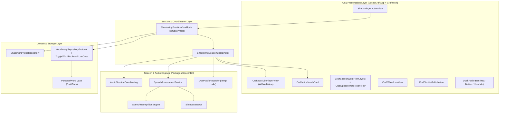

# YouTube Shadowing Studio Design Specification

- **Date:** 2026-10-21
- **Status:** Approved
- **Author:** Hooji Nguyen & Antigravity AI
- **Target:** `VocabCraftApp` & `Packages/SpeechKit` & `Packages/CraftUIKit`

---

## 1. Executive Summary & Product Goals

### 1.1 Overview
**YouTube Shadowing Studio** is an interactive, video-based speech training feature for `VocabCraft`. It empowers English learners to mimic authentic native speech from curated YouTube video excerpts (e.g., daily conversations, movies, tech talks, podcasts) using a **Consecutive Step-by-Step Shadowing (Echo Shadowing)** methodology.

### 1.2 Core Value Propositions
1. **Authentic Pacing & Intonation:** Practice with real-world videos rather than synthesized or monotonous textbook speech.
2. **Sub-second Precision Auto-Pause:** Videos automatically pause right at the end of each sentence, seamlessly transitioning the learner into the speaking stage.
3. **Objective Speech Diagnostics:** Instant phoneme & word alignment feedback (Green = exact match, Yellow = fuzzy match, Red = missing/mispronounced) powered by `SpeechKit`.
4. **Dual-Track Audio Self-Assessment:** Allows instant toggling between "Hear Native" (original video line) and "Hear Me" (user's recorded voice) to develop ear-to-mouth calibration.
5. **1-Tap Spaced Repetition (SRS) Integration:** Seamlessly bookmark missed or new words directly into the user's `PersonalWord` vault for subsequent Flashcard and Reflex Drill reviews.

---

## 2. Market Research & Industry Benchmarks

| Platform | Video Integration | Flow & Mechanics | Key Insights for VocabCraft |
| :--- | :--- | :--- | :--- |
| **eJOY English** | Embedded YouTube player with timed-text captions. | Breaks video into 1–3 min clips. Step-by-step: Listen $\rightarrow$ Auto-pause $\rightarrow$ Record $\rightarrow$ Color-coded feedback. | High retention when paired with an SRS word bank. |
| **Cake** | Short video clips (15–45s) focused on key conversational expressions. | Repeats the target line 3 times at varied speeds $\rightarrow$ Record and score A/B/C. | Micro-lessons prevent learner fatigue; clear focus on key expressions. |
| **Woodpecker** | YouTube player with interactive bilingual dictionary subtitles. | A-B repeating and 5-second rewind loops. Tap any subtitle word to look up definitions. | Instant word lookup during video playback significantly enhances comprehension. |
| **VoiceTube** | Curated daily YouTube clips (15–30s). | Daily Speaking Challenge: Listen $\rightarrow$ Record entire passage $\rightarrow$ Community feedback. | Structured daily habit formation. |

---

## 3. High-Level System Architecture



---

## 4. Domain & Data Models

### 4.1 Curated Video Content Models

```swift
import Foundation

public enum ShadowingTopic: String, Sendable, Codable, CaseIterable {
    case dailyLife
    case moviesAndSeries
    case businessEnglish
    case techAndScience
    case cultureAndTravel
}

public struct ShadowingVideo: Identifiable, Sendable, Codable, Equatable {
    public let id: String                    // e.g. "yt_daily_coffee_01"
    public let youtubeVideoId: String         // e.g. "dQw4w9WgXcQ"
    public let title: String                  // "Ordering Coffee Like a Native"
    public let topic: ShadowingTopic
    public let level: String                  // "A2", "B1", "B2"
    public let durationSeconds: Double
    public let sentences: [ShadowingSentence]
}

public struct ShadowingSentence: Identifiable, Sendable, Codable, Equatable {
    public let id: String                    // e.g. "s_01"
    public let orderIndex: Int
    public let startTime: Double             // In seconds (e.g. 14.5)
    public let endTime: Double               // In seconds (e.g. 19.2)
    public let textEn: String                // "Could I get a medium iced latte with oat milk?"
    public let textVi: String                // "Cho tôi một ly latte đá cỡ vừa với sữa yến mạch được không?"
    public let keyWords: [ShadowingKeyWord]
}

public struct ShadowingKeyWord: Identifiable, Sendable, Codable, Equatable {
    public var id: String { lemma }
    public let lemma: String                 // "latte"
    public let phonetic: String              // "/ˈlɑː.teɪ/"
    public let definitionVi: String          // "Cà phê sữa đá/nóng"
    public let definitionEn: String?
    public let linkedWordId: Int64?          // Maps to Word.id in local dictionary
}
```

### 4.2 Session State & Evaluation Models

```swift
@Observable
public final class ShadowingPracticeViewModel {
    public var currentVideo: ShadowingVideo
    public var currentSentenceIndex: Int = 0
    public var playbackPhase: ShadowingPlaybackPhase = .idle
    public var sentenceAttempts: [String: SentenceAttemptRecord] = [:]
    
    public var currentEvaluation: SpeechEvaluationResult?
    public var isRecording: Bool = false
    public var audioLevels: [CGFloat] = []
    public var playbackSpeed: Float = 1.0     // 0.75, 0.9, 1.0
    
    public var selectedKeyWordForPopover: ShadowingKeyWord?
    public var bookmarkedWordIds: Set<String> = []
}

public enum ShadowingPlaybackPhase: Equatable {
    case idle
    case playingNative(currentTime: Double)
    case readyToRecord
    case listening(levels: [CGFloat])
    case evaluating
    case evaluated(score: Double)
}

public struct SentenceAttemptRecord: Sendable, Equatable {
    public let score: Double
    public let userAudioURL: URL?
    public let wordTokens: [WordTokenResult]
    public let isPassed: Bool
}
```

---

## 5. Technical Implementation Details

### 5.1 YouTube IFrame Bridge & Sub-second Auto-Pause
To prevent IPC latency and bridge jitter, the auto-pause logic runs natively inside the `WKWebView` JavaScript execution loop using `requestAnimationFrame`:

```html
<!DOCTYPE html>
<html>
<head>
  <meta name="viewport" content="width=device-width, initial-scale=1.0, maximum-scale=1.0, user-scalable=no">
  <style>
    body, html { margin: 0; padding: 0; width: 100%; height: 100%; background: #000; overflow: hidden; }
    #player { width: 100%; height: 100%; pointer-events: none; }
  </style>
</head>
<body>
  <div id="player"></div>
  <script src="https://www.youtube.com/iframe_api"></script>
  <script>
    var player, targetEndTime = 0, isMonitoring = false;
    function onYouTubeIframeAPIReady() {
      player = new YT.Player('player', {
        videoId: 'VIDEO_ID_PLACEHOLDER',
        playerVars: { 'playsinline': 1, 'controls': 0, 'rel': 0, 'modestbranding': 1, 'disablekb': 1 },
        events: {
          'onReady': function() { window.webkit.messageHandlers.shadowingBridge.postMessage({type: 'ready'}); },
          'onStateChange': function(e) { window.webkit.messageHandlers.shadowingBridge.postMessage({type: 'state', state: e.data}); }
        }
      });
    }

    function playSegment(start, end, rate) {
      targetEndTime = end;
      player.setPlaybackRate(rate || 1.0);
      player.seekTo(start, true);
      player.playVideo();
      isMonitoring = true;
      requestAnimationFrame(checkTime);
    }

    function checkTime() {
      if (!isMonitoring) return;
      var current = player.getCurrentTime();
      if (current >= targetEndTime) {
        player.pauseVideo();
        isMonitoring = false;
        window.webkit.messageHandlers.shadowingBridge.postMessage({
          type: 'segmentFinished',
          endTime: targetEndTime
        });
      } else {
        requestAnimationFrame(checkTime);
      }
    }
  </script>
</body>
</html>
```

### 5.2 Audio Session Coordination
Leverages `AudioSessionCoordinating` from `SpeechKit` to ensure clean transitions:
1. **Playback Mode:** On playing segment, acquire lease with `.playback`. Audio routes cleanly to speaker or Bluetooth headset.
2. **Recording Mode:** On `segmentFinished` message, release `.playback` lease and acquire `.speechCapture`. Start `SpeechRecognitionEngine` and install audio tap to record temporary `.m4a` file.
3. **Silence Detection:** `SilenceDetector` detects 1.3s trailing silence $\rightarrow$ triggers `stop()` on `SpeechRecognitionEngine` $\rightarrow$ evaluates tokens via `SpeechAssessmentService`.

### 5.3 Word Alignment & Scoring
- `SequenceAligner` (Needleman-Wunsch) compares spoken tokens with `textEn`.
- Generates `[WordTokenResult]` with statuses:
  - `.exactMatch` (Score $\ge 0.85$, colored Green).
  - `.fuzzyMatch` (Score $0.60 - 0.84$, colored Yellow).
  - `.missing` (Unspoken or mispronounced, colored Red/Muted).

### 5.4 SRS 1-Tap Quick Bookmark
- Tapping any word token opens `CraftCard` popover.
- Displays: IPA, Vietnamese translation, and single-word pronunciation via `SherpaKokoroTTSWrapper`.
- Tapping "Add to Deck" executes `ToggleWordBookmarkUseCase` or creates `PersonalWord` in SwiftData context with `sourceDeckTitle: "Shadowing: [Video Title]"`.

---

## 6. UI / UX Design & CraftUIKit Integration

### 6.1 CraftUIKit-First Component Mapping
All UI elements reuse existing components in `Packages/CraftUIKit`:

- **Master Container:** `CraftVoiceMatchCard` (instruction header, score badge, word flow layout, live waveform, mic hub).
- **Word Display:** `CraftSpeechWordFlowLayout` + `CraftSpeechWordTokenView`.
- **Live Visualizer:** `CraftWaveformView` (audio buffer levels).
- **Tactile Mic Hub:** `CraftTactileMicHubView` (haptic-enabled mic button with breathing glow).
- **Progress:** `CraftProgressBar` (e.g. 3/8 sentences).
- **Controls & Actions:** `CraftButton` (`.primary` for Next/Retry, `.secondary` for Dual Audio comparison).
- **Pills:** `CraftPill` (speed selection: 0.75x, 0.9x, 1.0x).
- **Feedback:** `CraftCelebrationSheet` (session summary on finishing all sentences).

### 6.2 Token Conformance
- **Colors:** `theme.colors.brandPrimary`, `theme.colors.surfaceCard`, `theme.colors.statusSuccess`, `theme.colors.statusWarning`, `theme.colors.statusCritical`.
- **Typography:** `theme.typography.titleMedium`, `theme.typography.bodyMedium`, `theme.typography.label`.
- **Spacing & Radii:** `theme.spacing.sm`, `theme.spacing.md`, `theme.spacing.lg`, `theme.radii.lg`, `theme.radii.xl`.
- **Zero Raw Colors / Hardcoded Dimensions.**

---

## 7. Localization Strategy (Zero Hardcoded Strings)

All strings reside in `VocabCraftApp/Resources/Localizable.xcstrings` (Layer 2 `app.*`):

| Key | English (`en`) | Vietnamese (`vi`) |
| :--- | :--- | :--- |
| `app.shadowing.title` | "Shadowing Practice" | "Luyện Shadowing" |
| `app.shadowing.progress_format` | "Sentence %lld of %lld" | "Câu %lld / %lld" |
| `app.shadowing.speed` | "Speed: %@" | "Tốc độ: %@" |
| `app.shadowing.action.hear_native` | "Hear Native" | "Nghe bản xứ" |
| `app.shadowing.action.hear_me` | "Hear Recording" | "Nghe bản thu" |
| `app.shadowing.action.retry` | "Try Again" | "Thử lại" |
| `app.shadowing.action.next_sentence` | "Next Sentence" | "Câu tiếp theo" |
| `app.shadowing.srs.add_to_vault` | "Save to Review Deck" | "Lưu vào Deck ôn tập" |
| `app.shadowing.srs.saved_success` | "Saved to your vault!" | "Đã lưu vào danh sách ôn tập!" |
| `app.shadowing.celebration.title` | "Shadowing Completed!" | "Hoàn thành bài Shadowing!" |
| `app.shadowing.celebration.message` | "You practiced %lld sentences with an average score of %lld%%." | "Bạn đã luyện %lld câu với điểm trung bình %lld%%." |

---

## 8. Verification & Quality Gates

Before declaring any implementation complete, the following gates must pass:
1. **Localization Verification:** `swift test --filter LocalizationTests` (100% EN/VI parity).
2. **Audio & SpeechKit Unit Tests:** Verify `ShadowingSessionCoordinator`, Needleman-Wunsch token alignment, and audio session lease acquisition.
3. **SwiftLint & Compiler Diagnostics:** 0 errors, 0 warnings, strict concurrency compliance.
4. **Simulator & Device Verification:** Test YouTube playback, sub-second pause, mic input, and dual audio replay.
