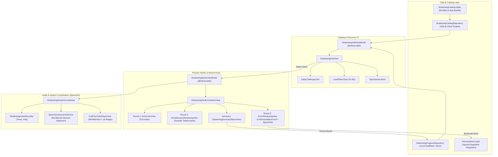

# YouTube Shadowing Studio (Production Grade) Design Specification

- **Date:** 2026-10-22
- **Status:** Approved
- **Author:** Hooji Nguyen & Antigravity AI
- **Target:** `VocabCraftApp`, `Packages/CraftUIKit`, `Packages/SpeechKit`
- **Specification Path:** `docs/superpowers/specs/2026-10-22-youtube-shadowing-production-design.md`

---

## 1. Executive Summary & Intent

### 1.1 The "Why"
Traditional language learning apps often force learners into robotic, synthetic dialogues that lack the natural cadence, colloquial rhythm, and emotional pitch of real-world speech. Conversely, watching raw YouTube videos is overwhelmingly fast and passive: learners miss words, freeze when overwhelmed, and fail to build muscle memory.

**YouTube Shadowing Studio** transforms the existing single-video demo into an authentic, production-ready speech training system. It enables learners to practice real English from curated YouTube excerpts (< 5 minutes) via a structured **3-Round Progression (15-Minute Daily Habit)** that bridges comprehension, speed agility, and pinpoint pronunciation accuracy.

### 1.2 Target Audience & Use Case
English learners (CEFR A1–B2) seeking to improve their speaking reflexes, fluency, and pronunciation intonation in short, high-focus daily sessions (15 minutes).

---

## 2. Goals, Non-Goals & Anti-Goals

### 2.1 Goals
1. **Structured 3-Round Pedagogical Progression**:
   - **Round 1 (Watch & Absorb ~2–3 min):** Continuous video playback for contextual and melodic comprehension with optional bilingual subtitles.
   - **Round 2 (Simultaneous Shadowing ~3–4 min):** Real-time speaking along at video speed, supported by an interactive Karaoke Teleprompter, pacer word highlight, 0.85x speed button, and a 5s rewind button.
   - **Round 3 (Echo Shadowing & Diagnostics ~7–8 min):** Sentence-by-sentence precision drilling with sub-second auto-pause, on-device `SpeechKit` word alignment (Green/Yellow/Red), dual-track comparison ("Hear Native" vs "Hear Me"), and 1-tap SRS saving.
   - **Summary Report (~1 min):** Session mastery score (%), list of newly mastered/saved words, optional replay of Round 2 full voice memo, XP gain, and streak continuation.
2. **Shadowing Studio Hub (Catalog & Discovery Screen)**:
   - Hero "Daily 15-Minute Challenge" card for instant daily habit engagement.
   - CEFR level filter chips (`All`, `A1 Sơ cấp`, `A2 Cơ bản`, `B1 Trung cấp`, `B2 Nâng cao`).
   - Categorized topic rails (`Daily Life`, `Movies & TV Series`, `Work & Business`, `Tech & Trends`).
   - Rich video card metadata: 16:9 thumbnail, duration pill, level badge, sentence count, and past mastery score (e.g. ⭐ 94%).
3. **Backend-Driven SQLite Data Architecture (V1 Bundle)**:
   - Clean separation of concerns: Backend handles 100% of subtitle scraping, sentence boundary segmentation, timestamp alignment, IPA phonetics, and Vietnamese translations, packaged into a standalone SQLite catalog (`ShadowingCatalog.sqlite`).
   - Bundled inside the application bundle (`Bundle.main`) for V1, guaranteeing 100% offline availability, zero API latency, and rock-solid stability without network download dependencies.
4. **Local Progress Persistence & SRS Integration**:
   - Save session scores and weak/bookmarked words into the learner's local database (`PersonalWord` vault) to feed Spaced Repetition (Flashcards & Reflex Drills).

### 2.2 Non-Goals
1. **Client-side YouTube Scraping / AI Subtitle Generation:** The iOS app will not perform raw subtitle downloading, scraping, or heavy NLP segmentation. All content is pre-compiled by the backend.
2. **Arbitrary User-Pasted YouTube URLs in V1:** Version 1 relies exclusively on the curated SQLite catalog. Custom URL ingestion will be a backend worker feature in future versions.
3. **Cloud Audio Storage:** User voice recordings are strictly ephemeral (stored locally in temporary storage for the duration of the session for comparison and privacy, never uploaded to a cloud server).
4. **Remote Catalog Sync in V1:** Catalog updates will ship with app releases in V1, deferring dynamic catalog downloads to a subsequent release.

### 2.3 Anti-Goals
- **No Overwhelming Video Lengths:** No videos exceeding 5 minutes. Extended videos induce vocal fatigue and break the 15-minute daily habit.
- **No Acoustic Bleed:** Prevent video audio playback from entering the microphone during recording (explicit headphone prompts and audio session coordination).
- **No Hardcoded Strings & Zero Raw Styles:** Strictly comply with `CraftUIKit` design tokens and 100% bilingual `Localizable.xcstrings` (EN & VI).

---

## 3. High-Level Architecture & Data Flow



---

## 4. Detailed Component Specifications

### 4.1 Shadowing Studio Hub (`ShadowingHubView`)
- **Navigation Entry:** Accessible via the main app tab or `AIAssistantHubView`.
- **Header:** Title "Shadowing Studio", subtitle, and current learning streak badge (`🔥 X ngày streak`).
- **Hero Card (Daily 15-Minute Challenge):**
  - Displays today's recommended video based on learner level.
  - Metrics: Title, topic, CEFR badge, duration (< 3 mins), sentence count.
  - Prominent CTA: "Bắt đầu luyện ▶".
- **Level Filter Bar:**
  - Segmented pills: `All`, `A1`, `A2`, `B1`, `B2`.
  - Filters all lists below in real-time.
- **Topic Sections:**
  - Grouped by `ShadowingTopic` (`dailyLife`, `moviesAndSeries`, `businessEnglish`, `techAndScience`, `cultureAndTravel`).
  - Video item cards containing:
    - 16:9 thumbnail with duration badge (e.g. `02:15`).
    - CEFR badge & status badge (e.g. `⭐ 92%` or `Chưa luyện`).
    - Title and context note (e.g. `5 câu • Giọng Mỹ tự nhiên`).

### 4.2 The 3-Round Practice Studio (`ShadowingStudioContainerView`)

#### Round 1: Immersion & Context Comprehension (~2–3 mins)
- **Goal:** Absorb story context, speaker emotional tone, and intonation without speech anxiety.
- **Player:** Continuous playback from $t=0$ to end.
- **Subtitles:** Bilingual toggle (EN / VI / None).
- **Controls:** Play/Pause, Replay, "Bỏ qua sang Vòng 2" or auto-transition upon video completion.

#### Round 2: Simultaneous Shadowing (~3–4 mins)
- **Goal:** Build motor speech muscle memory and speaking velocity by shadowing in real-time (1–2 words lag behind the speaker).
- **Player:** Continuous playback.
- **Headphone Policy:**
  - Advisory prompt: "Đeo tai nghe để trải nghiệm tốt nhất".
  - If headphones are connected: Full-session audio recording is enabled via `ShadowingAudioRecorder`.
  - If headphones are NOT connected: Playback proceeds normally without blocking the user, but background audio recording is safely bypassed to prevent loudspeaker acoustic bleed into the microphone.
- **Karaoke Teleprompter Card:**
  - High-contrast, large-typography card below the video.
  - **Pacer Word Highlight:** The active word being pronounced lights up with a prominent pill/color glow based on `words_json` timestamps (or proportional fallback).
  - Past words turn soft green.
  - Upcoming words stay muted gray.
  - A subtle 1-line preview of the next sentence is rendered underneath to prepare ocular gaze.
- **Speed Quick-Toggle:** Switch easily between `1.0x` and `0.85x` (to accommodate rapid-fire colloquial speech).
- **Rewind 5s Button:** 1-tap skip back 5 seconds if learner stumbles, preventing panic or restarting from scratch.

#### Round 3: Echo Shadowing & Diagnostics (~7–8 mins)
- **Goal:** Micro-level phoneme accuracy, intonation calibration, and vocabulary acquisition.
- **Player:** Sub-second auto-pause at sentence boundary (`endTime`).
- **Voice Match Card (`CraftVoiceMatchCard`):**
  - Target sentence (English) + translation (Vietnamese).
  - Tap mic to record $\rightarrow$ `SpeechKit` real-time acoustic recognition.
  - Color-coded word token evaluation:
    - **Green (`.exactMatch`):** Word pronounced accurately.
    - **Yellow (`.fuzzyMatch`):** Close pronunciation, minor vowel/consonant slip.
    - **Red (`.missing` / `.mispronounced`):** Skipped or inaccurate word.
  - Overall accuracy score (0–100%).
- **Dual-Track Audio Bar:**
  - "Hear Native" (original video audio excerpt).
  - "Hear Me" (recorded user voice clip).
- **Key Words & 1-Tap SRS Bookmark:**
  - Interactive chip badges for highlighted key words.
  - Tap chip $\rightarrow$ Popover displaying IPA phonetic, Vietnamese definition, English definition.
  - If `linkedWordId` is present $\rightarrow$ "Lưu vào Deck ôn tập" executes `ToggleWordBookmarkUseCase(wordId:)` to persist in `PersonalWord`. If null $\rightarrow$ saved to local favorite expressions.

#### Session Summary Report (`ShadowingSummaryReportView`)
- **Metrics Presented:**
  - Overall session mastery score (average % across all sentences in Round 3).
  - Practice duration (~15 mins).
  - Number of sentences completed.
  - List of saved vocabulary words.
  - **Round 2 Full Voice Memo Replay:** If headphones were worn and a recording was captured, users can listen back to their continuous speech recording here.
  - Streak increment & XP reward celebration.
- **Actions:** "Hoàn thành" (dismiss to Hub) or "Luyện lại những câu yếu".

---

## 5. Data Models & Database Schema

### 5.1 SQLite Catalog Schema (`ShadowingCatalog.sqlite`)

```sql
CREATE TABLE topics (
    id TEXT PRIMARY KEY NOT NULL,
    title_en TEXT NOT NULL,
    title_vi TEXT NOT NULL,
    icon_name TEXT NOT NULL,
    display_order INTEGER NOT NULL
);

CREATE TABLE videos (
    id TEXT PRIMARY KEY NOT NULL,
    youtube_video_id TEXT NOT NULL,
    title TEXT NOT NULL,
    topic_id TEXT NOT NULL REFERENCES topics(id),
    level TEXT NOT NULL, -- 'A1', 'A2', 'B1', 'B2', 'C1'
    duration_seconds REAL NOT NULL,
    thumbnail_url TEXT,
    accent TEXT DEFAULT 'American', -- 'American', 'British', etc.
    display_order INTEGER NOT NULL
);

CREATE TABLE sentences (
    id TEXT PRIMARY KEY NOT NULL,
    video_id TEXT NOT NULL REFERENCES videos(id),
    order_index INTEGER NOT NULL,
    start_time REAL NOT NULL,
    end_time REAL NOT NULL,
    text_en TEXT NOT NULL,
    text_vi TEXT NOT NULL,
    words_json TEXT -- JSON array: [{"word": "Can", "start": 1.2, "end": 1.5}, ...]
);

CREATE TABLE sentence_keywords (
    id TEXT PRIMARY KEY NOT NULL,
    sentence_id TEXT NOT NULL REFERENCES sentences(id),
    lemma TEXT NOT NULL,
    phonetic TEXT NOT NULL,
    definition_vi TEXT NOT NULL,
    definition_en TEXT,
    linked_word_id INTEGER -- Maps to core vocabulary dictionary if available
);
```

### 5.2 Local Progress Persistence (`ShadowingProgressRecord`)

```swift
public struct ShadowingProgressRecord: Codable, Sendable, Identifiable {
    public var id: String { videoId }
    public let videoId: String
    public var bestScore: Double
    public var lastCompletedAt: Date
    public var timesCompleted: Int
    public var sentenceScores: [String: Double] // [sentenceId: score]
}
```

---

## 6. Design System Conformance & Localization

### 6.1 CraftUIKit Design Tokens
- **Colors:** `theme.colors.canvasBackground`, `theme.colors.surfacePrimary`, `theme.colors.textPrimary`, `theme.colors.textSecondary`, `theme.colors.accentPurple`, `theme.colors.successGreen`.
- **Typography:** `theme.typography.displayMedium`, `theme.typography.titleLarge`, `theme.typography.bodyMedium`, `theme.typography.caption`.
- **Components:** `CraftVoiceMatchCard`, `CraftYouTubePlayerView`, `CraftButton`, `CraftPill`, `CraftBadge`, `CraftProgressBar`.
- **Zero raw colors, zero raw hardcoded fonts.**

### 6.2 Localization Keys (`Localizable.xcstrings`)

| Key | English (`en`) | Vietnamese (`vi`) |
| :--- | :--- | :--- |
| `app.shadowing.hub.title` | "Shadowing Studio" | "Shadowing Studio" |
| `app.shadowing.hub.subtitle` | "Master spoken reflexes with real videos" | "Luyện phản xạ nói qua video ngắn" |
| `app.shadowing.hub.daily_challenge` | "TODAY'S 15-MIN CHALLENGE" | "BÀI HỌC HÔM NAY (15 PHÚT)" |
| `app.shadowing.hub.filter_all` | "All Levels" | "Tất cả" |
| `app.shadowing.round1.title` | "Round 1: Watch & Absorb" | "Vòng 1: Nghe & Cảm nhận" |
| `app.shadowing.round2.title` | "Round 2: Speed Shadowing" | "Vòng 2: Shadow đuổi tốc độ" |
| `app.shadowing.round2.pacer_hint` | "Shadow 1-2 words behind speaker" | "Nói đuổi chậm hơn video 1-2 từ" |
| `app.shadowing.round2.headphone_advisory` | "Connect headphones for recording" | "Đeo tai nghe để trải nghiệm tốt nhất" |
| `app.shadowing.round2.rewind_5s` | "Rewind 5s" | "Lùi 5s" |
| `app.shadowing.round2.speed` | "Speed: %@" | "Tốc độ: %@" |
| `app.shadowing.round3.title` | "Round 3: Deep Drill & Score" | "Vòng 3: Khoan sâu từng câu" |
| `app.shadowing.summary.title` | "Session Completed!" | "Hoàn thành buổi luyện!" |
| `app.shadowing.summary.score_format` | "Mastery Score: %lld%%" | "Điểm phản xạ: %lld%%" |
| `app.shadowing.summary.round2_audio` | "Listen to Speed Shadowing" | "Nghe lại bản thu Shadow đuổi" |

---

## 7. What is Left to the Builder

1. **SQLite Driver Integration:** Use lightweight SQLite API / driver to query `ShadowingCatalog.sqlite` from `Bundle.main`.
2. **Animation Curves:** Exact transition springs between Round 1 $\rightarrow$ Round 2 $\rightarrow$ Round 3 and the Karaoke glowing pacer highlight duration.
3. **Headphone Detection:** Observe `AVAudioSession.sharedInstance().currentRoute` to toggle the green "Headphones Connected" status badge and enable/disable Round 2 recording.
4. **Seed Content:** Include at least 5 curated video lessons across A1, A2, and B1 in the bundled SQLite file for testing and immediate user delight.
